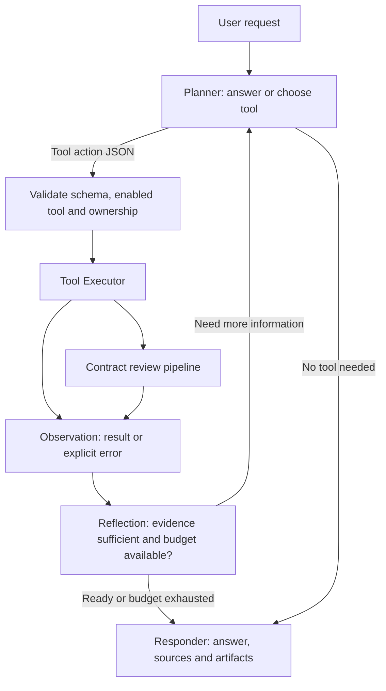
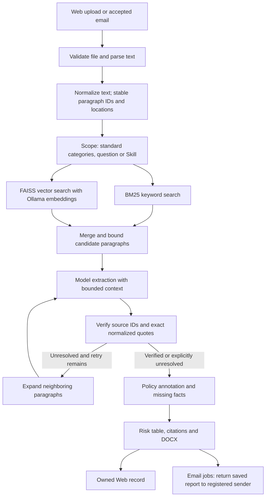

# Contract Review Agent — CSIT6000V

Evidence-grounded contract review, general tool-assisted conversation and automatic email intake in a three-panel Web workspace.

**Updated: 2026-11-22**

The course assessment backend is **TACC Qwen**. An independent OpenAI-compatible API and local Ollama are supported for development.

## Getting Started Instructions

Prerequisites: Git and Python 3.12.x. Node is not required for the packaged demo. No API key is required for the offline check.

```bash
git clone https://github.com/Ray-WONG42/csit6000v-contract-review-agent.git
cd csit6000v-contract-review-agent
python3 -m venv .venv
.venv/bin/python -m pip install -r requirements.txt
cp .env.example .env
.venv/bin/python demo.py
```

On Windows, use `python` and `.\.venv\Scripts\python.exe` as in the reproduction section below. `.env.example` sets `CONTRACT_VECTOR_SEARCH=1`. The offline demo does not call Ollama or TACC.

Expected result: exit code 0. The command prints one JSON line per stage, then ends with:

```json
{"status":"PASS","mode":"demo","tool_called":true,"artifact_count":1}
```

Then `.venv/bin/python scripts/launch.py` serves the workbench at `http://127.0.0.1:8765`. Sign in as `legal@example.com` / `LegalDemo2026!` and upload `fixtures/Acme-Service-Agreement.pdf`. The risk table should show the eight review rows, with citations that open the source paragraph.

## Detailed Instructions

Main comparison:

```bash
.venv/bin/python evals/run.py --manifest fixtures/eval-manifest.json --mode demo --output data/evaluation-results.json
```

Test cases are the two synthetic contracts in `fixtures/eval-manifest.json`: `Acme-Service-Agreement.txt` (positive gold spans) and `Negative-Contract.txt` (empty gold for every category). Gold categories are termination, liability cap, governing law, automatic renewal, audit rights, assignment, insurance, and agreement date. The command runs `full`, `bm25`, and `retrieval` on each. `data/evaluation-results.json` records, per method, hit rate at token-overlap F1 0.5, mean span F1, false-positive rate, unresolved pairs, token counts, and median and 95th-percentile seconds. In demo mode the file note says the run checks the harness, not live model quality. The command does not build FAISS hits and it is not a CUAD score.

Also:

```bash
.venv/bin/python -m pytest -q
.venv/bin/python scripts/smoke_web.py
```

Optional vector check, after `ollama pull embeddinggemma:300m-qat-q4_0`:

```bash
.venv/bin/python scripts/check_embeddings.py
```

Known limits: demo mode does not measure live Qwen quality. A full CUAD holdout, a live mailbox round trip, and cloud storage are not results of the offline commands. On Windows, `scripts/smoke_web.py` can exit nonzero after a functional pass because temporary SQLite cleanup hits `WinError 32`. `CONTRACT_VECTOR_SEARCH=1` requests FAISS candidates when an embedding service is reachable; if it is not, review continues with BM25.

## Contents

- [Getting Started Instructions](#getting-started-instructions)
- [Detailed Instructions](#detailed-instructions)
- [Project Overview](#project-overview)
- [Architecture](#architecture)
- [Environment Prerequisite](#environment-prerequisite)
- [Hardware note](#hardware-note)
- [Step-by-step Reproduction](#step-by-step-reproduction)
- [Demo Test Case](#demo-test-case)
- [Agent Configuration Guide](#agent-configuration-guide)
- [Troubleshooting FAQ](#troubleshooting-faq)
- [License](#license)

## Project Overview

### Capabilities

| Capability | Implemented behavior |
|---|---|
| Contract intake | Web upload or administrator-mailbox attachment |
| Standard review | Eight clause categories, verified quotations and downloadable DOCX |
| Targeted review | Current question, custom Skill focus and custom checks |
| General conversation | Answer questions; search public information; read pages/contracts; save Skills; create documents |
| Evidence | Stable paragraph IDs, original locations and quotation validation |
| Retrieval | BM25 plus optional vector search; section-aware chunks and bounded expansion |
| Three-panel Web | History/company grouping, current chat/tool events, source/risk table/report panel |
| Bilingual UI | Chinese/English interface, output instructions and preset files |
| Private Skills | Account-owned reusable checks with version snapshots |
| Automatic email | Review registered legal users' contracts through TACC and reply with saved results |
| Execution harness | Durable jobs, checkpoints, ownership, submission and delivery records |

### Agent workflow

The Planner selects an answer or a tool. The Tool Executor validates arguments and account permissions, executes the action and returns an observation. The next planning step checks whether the result is sufficient and whether another tool fits the remaining budget. The Responder returns an answer, evidence or downloadable artifact.

“Reflection” means assessing observations inside this bounded loop. It is not a separate critic agent or a display of private chain-of-thought. Each turn allows at most **six tool executions**, followed by a final-answer-only step.



### Contract processing



The optimized API/TACC path normally merges retrieval candidates and batches built-in checks in groups of up to three. It does **not** require an extra whole-contract model survey before every review. Other paths can survey section-aware chunks. Oversized extraction requests are split into smaller candidate groups; each group's evidence is verified separately before merging.

### Default categories and targeted questions

| ID | Category |
|---|---|
| `termination` | Termination |
| `liability_cap` | Liability cap |
| `governing_law` | Governing law |
| `automatic_renewal` | Automatic renewal |
| `audit_rights` | Audit rights |
| `assignment` | Assignment |
| `insurance` | Insurance |
| `agreement_date` | Agreement date |

These are defaults, not the required answer format for every question. A selected Skill can specify categories, focus, custom items and a policy. Current instructions can add a targeted question. Unsupported scope, such as tracked changes to the original contract or multi-contract comparison, returns a clarification instead of pretending the operation succeeded.

### Automatic administrator-mailbox review

**The configured administrator mailbox automatically reviews contract attachments from registered legal accounts through TACC and emails the generated result back to the registered original sender.** With `MAIL_POLL_SECONDS=60`, the worker checks for new mail approximately once per minute while running.

1. A registered legal user emails one supported contract attachment to the administrator mailbox.
2. The worker polls new messages, matches the sender to the registered account and saves an intake receipt.
3. The TACC review pipeline processes the contract and saves verified findings and the final report.
4. The worker emails the saved result back to the registered original sender.

- The sender must match a **registered legal account**. Intake and results belong to that account.
- Each message must contain **one valid supported contract attachment**; multiple valid attachments are not silently merged.
- Live email intake uses the standard review instruction and **always selects TACC**, independently of the Web model selection or `MODEL_MODE` default. It does not fall back to DeepSeek/API or Ollama. Offline `MODEL_MODE=demo` remains a deterministic local demonstration.
- New email reviews use the sending legal account's saved interface/output language. Optional subject `[LANG=en]` or `[LANG=zh]` overrides the account preference for that message. Quotations preserve their source language.
- The recipient comes from the account/intake record, **never from model output**.
- Receipts, mailbox cursors and saved delivery states reduce repeated processing. Uncertain sends require reconciliation rather than blind retries.
- Oversized report attachments use a login/download notice.
- Initial synchronization establishes a baseline rather than processing all historical mail. Register first, then send a new message.
- API and worker must remain running; a browser tab alone does not poll the mailbox.

## Architecture

This is **one bounded tool-calling agent plus a review pipeline and durable harness**, not a multi-agent message system.

### Components and technology stack

| Layer | Implementation | Responsibility |
|---|---|---|
| Web | React 19, TypeScript, Vite 6; `web/src/` | Three-panel UI, bilingual interface, local account-scoped history |
| API | FastAPI, Pydantic; `app/main.py` | Sessions, upload/download, ownership, jobs, Skills and mail metadata |
| Planner / Tool Executor | `app/assistant.py`, `app/web_tools.py` | JSON planning, schemas, tool execution and bounded Web access |
| Review / Responder | `engine.py` | Scope, extraction, quote verification, policy annotation and reports |
| Retriever | `engine.py`, `app/retrieval.py` | BM25, optional Ollama/FAISS, semantic chunks and expansion |
| Memory | Browser IndexedDB/localStorage; SQLAlchemy/SQLite WAL | UI history and private backend task recovery |
| Harness | `app/worker.py`, `app/services.py` | Leases, checkpoints, retries, intake and delivery |
| Model transport | `engine.py`, `app/tacc_sdk.py`, `tacc/` | Independent API, Ollama and course SDK |
| Mail | `gmailbox.py`, `gmail_imap.py`, `mailbox.py` | Gmail HTTPS OAuth, IMAP/SMTP alternative, Outlook Graph adapter |
| Prompt/templates | `prompts/`, `templates/zh/`, `templates/en/` | External instructions and bilingual examples |
| Verification | `tests/`, `scripts/`, `evals/run.py` | Synthetic regression, diagnostics and experiments |
| Packaging | `Dockerfile`, `compose.yaml`, `deploy/` | API/worker containers with shared storage |

API and worker are separate processes using a SQLite-backed queue. Redis/Celery are not required. FastAPI serves the committed frontend and relative `/api` routes from one origin.

### Retrieval

The review pipeline combines BM25 keyword ranking with optional Ollama/FAISS vector search. Section-aware chunks and neighboring-paragraph expansion preserve useful context; candidate merging keeps model input bounded and source paragraph IDs traceable. If embeddings are unavailable, the job records a fallback and continues with other candidates. See the optional setup below to enable vectors.

### Evidence, policy and output states

Parsing creates stable IDs such as `P0001` and source locations. Quotations must match normalized text from a paragraph actually supplied to that extraction call. Invalid IDs or invented quotes cannot become accepted evidence.

| State | Meaning |
|---|---|
| Row `found` | Verified evidence extracted; does not itself mean legal compliance |
| Row `not_found` | No supported evidence found |
| Row `review` | Extraction/verification unresolved |
| Job `completed` / `partial` | Complete / some checks unresolved |
| Job `failed` / `needs_input` | Execution failed / clarification required |

Skills and policies are version-snapshotted. `evidence-only@1` leaves compliance to human review. `supplier-demo@1` includes a narrow automatic-renewal example: an explicit, unambiguous calendar-day notice period of at least 30 days meets that demonstration rule. Missing/conflicting facts remain unresolved. These are not a complete market audit standard or legal certification.

### Permissions and storage

| Resource | Legal user | Administrator |
|---|---|---|
| Original input / final report | Own records | Across accounts |
| Private chat / task traces | Own records | No cross-user access |
| Private Skills / drafts | Own records | No cross-user access |
| Administrator inbox metadata | No; shows administrator address | Recent 24-hour list |
| Login shortcuts | Email only; user enters password | Same behavior |

There are two roles, `legal` and `admin`. Multiple legal accounts have identical role permissions but independent records. Public registration cannot choose administrator privileges.

The login screen supports email-only shortcuts for two legal accounts and an administrator. Clicking fills email without providing/changing the password; show/hide controls the password display.

The circular language button is in the top-right corner. English is the default for a fresh browser and accounts without a saved preference. A signed-in selection is saved per account and controls new chat replies, generated reports and automatic review emails. Login restores that account's preference. Existing jobs keep their original language snapshot; changing the interface does not translate old reports or source quotations.

Chat history persists locally in the browser. Backend runs/checkpoints can also contain private requests and observations. `APP_DATA` stores account data, original files and reports; default storage is local filesystem, not a provisioned object store. Selected text/prompts are sent to the chosen model backend, so local files do not imply local-only inference.

### Context and recovery harness

- Preserve the current question; consider up to eight prior turns, keeping the latest two and compressing earlier relevant content into extractive summaries.
- Deduplicate tool observations and pack compact recent results. Full checkpoints remain private.
- Paginate contract reads with `start`, `limit`, `query` and `next_start`; expose coverage and truncation metadata.
- Compact tool schemas/JSON without removing validation; reserve output and serialization margin.
- Use a conservative UTF-8 size bound, not an exact model tokenizer. Reduce summaries/excerpts before sending; report irreducible overflow explicitly.
- Split oversized extraction groups, validate each group's quotes and merge evidence.
- Persist request identity, job leases, checkpoints and SDK submission receipts. Unknown submissions require inspection/adoption.
- A local client polling window expiring does not fail a queued or running TACC job. The worker retains its job ID and resumes waiting; transient result-read connections are also retried without resubmission. Confirmed remote failures still surface as errors.
- Track delivery separately from review completion; network ambiguity prevents a general exactly-once delivery guarantee.

See [context management](docs/CONTEXT_MANAGEMENT.md).

### Directory tree and Git boundaries

```text
.
├── README.md, LICENSE, NOTICE, AGENTS.md       [C] documentation and terms
├── .env.example, .gitignore, .dockerignore     [C] safe templates/exclusions
├── requirements.txt, requirements-lock.txt    [C] exact Python pins
├── demo.py, run_agent.sh                      [C] offline entry points
├── engine.py, prompt_loader.py               [C] review engine
├── gmailbox.py, gmail_imap.py, mailbox.py      [C] mail adapters
├── app/                                      [C] API, planner, worker, persistence
├── prompts/                                  [C] external prompt templates
├── templates/{zh,en}/                        [C] bilingual example inputs
├── web/
│   ├── src/, package.json, package-lock.json [C] frontend source/lock
│   ├── openapi.json                          [C] generated API schema
│   ├── dist/                                [C] prebuilt public frontend
│   └── node_modules/                        [P] installed dependencies
├── tacc/{serve,client,probe}/                 [C] course submission logic
├── scripts/, tests/, fixtures/, evals/        [C] checks and synthetic examples
├── migrations/, deploy/, Dockerfile          [C] database/deployment support
├── compose.yaml, docs/                       [C] deployment and further guides
├── .env                                      [P] private configuration
├── data/                                     [P] accounts, contracts, reports, OAuth, logs
├── .runtime/, .venv/, release/                [P] local runtime/environment/archive
└── models/, weights/, vector_store/           [P] excluded if created locally
```

`[C]` must be committed; `[P]` must stay private/untracked. Generated `web/dist` and `web/openapi.json` are deliberately committed. Full exclusions: [.gitignore](.gitignore). Public manifest: [PACKAGING.md](docs/PACKAGING.md). Never upload the whole working directory indiscriminately.

## Environment Prerequisite

- **Git and Python 3.12**, tested interpreter 3.12.14. Use a dedicated venv.
- Exact dependency pins: [requirements.txt](requirements.txt), [requirements-lock.txt](requirements-lock.txt).
- No Node required for the packaged Web. Frontend development needs Node 22+ and `npm ci` using the lockfile.
- Real TACC: your own course authorization, official `tcloud` SDK, Linux/WSL and course runtime.
- Optional embeddings: Ollama and the embedding model. No persistent knowledge-base import step.
- Real email/Web tools require their own authorization/network access.
- Optional CUAD data uses Git LFS and is unnecessary for startup or synthetic tests.

| Dependency | Version | Use |
|---|---|---|
| FastAPI / Uvicorn | 0.162.7 / 0.54.0 | API/server |
| SQLAlchemy / Alembic | 2.1.8 / 1.20.1 | Persistence/migrations |
| Pydantic | 2.14.3 | Typed validation |
| pypdf / python-docx | 7.1.0 / 1.2.0 | Parsing/Word output |
| FAISS CPU / NumPy | 1.16.0 / 2.5.4 | Vector indexing |
| httpx / pytest | 0.28.1 / 9.2.0 | HTTP/tests |

`rank-bm25` is installed, but runtime scoring is implemented in `engine.Retrieval`. Frontend exact dependency resolutions are in `web/package-lock.json`.

| `MODEL_MODE` | Backend | Requirements |
|---|---|---|
| `demo` | Deterministic offline | Workflow check; not general natural-language reasoning |
| `api` | OpenAI-compatible HTTP, including configured DeepSeek | `LLM_BASE_URL`, `LLM_API_KEY`, `MODEL_NAME` |
| `tacc` | Course Qwen SDK; approved HTTP transport also available | Authorized SDK and available cluster service |
| `ollama` | Native local Ollama chat | Running daemon and downloaded chat model |

Compatible vLLM/LiteLLM endpoints can use the HTTP adapter if they satisfy its chat and JSON requirements. Compatibility does not mean every provider was live-tested. Native Anthropic Messages is unsupported. Search uses Bing RSS or optional Brave; no SerpAPI or unrestricted code interpreter is exposed.

## Hardware note

The Web/API, parsing and BM25 are CPU workloads. **No local GPU is required for API/TACC inference.** FAISS uses the CPU package; local embeddings require Ollama and memory for the small embedding model.

The course launcher requests two GPUs, tensor parallelism 2, 16K context, single concurrency and 55% vLLM memory utilization. Startup checks require at least 14,000 MiB free on each allocated GPU. Availability can change on the shared cluster. Cleanup targets this job's own process group, not other users' processes.

Optional local chat defaults to `gemma4:12b`. Memory depends on quantization/context. A local chat model is unnecessary when using API/TACC plus local embeddings. Never commit model weights.

## Step-by-step Reproduction

### 1. Clone, install and start offline

Choose a platform. Ensure the version command shows Python 3.12.x.

**Windows PowerShell**

```powershell
git clone https://github.com/Ray-WONG42/csit6000v-contract-review-agent.git
cd csit6000v-contract-review-agent
python --version
python -m venv .venv
.\.venv\Scripts\python.exe -m pip install -r requirements.txt
Copy-Item .env.example .env
.\.venv\Scripts\python.exe demo.py
.\.venv\Scripts\python.exe scripts/launch.py
```

**Linux / macOS**

```bash
git clone https://github.com/Ray-WONG42/csit6000v-contract-review-agent.git
cd csit6000v-contract-review-agent
python3 --version
python3 -m venv .venv
.venv/bin/python -m pip install -r requirements.txt
cp .env.example .env
.venv/bin/python demo.py
.venv/bin/python scripts/launch.py
```

Open `http://127.0.0.1:8765`. Keep the launcher open; Ctrl+C stops API/worker. In subsequent commands, `python` means the venv interpreter above.

| Public offline demo account | Demo password |
|---|---|
| `legal@example.com` | `LegalDemo2026!` |
| `other@example.com` | `OtherDemo2026!` |
| `admin@example.com` | `AdminDemo2026!` |

These are public test fixtures, not real account credentials. `APP_DEMO=1` enables demo identities; `MAIL_DEMO=1` keeps email local; `MODEL_MODE=demo` selects offline responses. Configure them independently.

Sign in with one of the demo accounts above. To submit a contract, unzip `CUAD_eight_label_contracts.zip` in the repository root and upload one PDF from the `CUAD_eight_label_contracts/` folder.

Do not overwrite an existing private `.env` when updating. Existing installations can run `python -m alembic upgrade head` before restarting. Use fresh `APP_DATA` for a separate installation and avoid conflicting launchers.

### 2. Configure a real independent API

Edit private `.env` using the provider's actual base URL, key and available model:

```dotenv
MODEL_MODE=api
LLM_BASE_URL=https://api.example.com/v1
LLM_API_KEY=
MODEL_NAME=
LLM_TEMPERATURE=0
LLM_CONTEXT_LIMIT=65536
LLM_MAX_OUTPUT_TOKENS=4000
LLM_TIMEOUT=90
```

The URL is a placeholder, not a working service. Use an API base, not a browser chat page. Match limits to the real provider. Restart API/worker and run `python scripts/check_connections.py --live`.

The Web selector keeps API and Qwen TACC separate. Web chats and reviews use the selected backend; choosing API for a Web request does not submit a TACC job. Automatic email reviews are routed separately and remain fixed to TACC.

When TACC is configured, it appears first and is the default for new Web requests. Users can select DeepSeek/API or an installed Ollama chat model instead, and explicit choices are remembered per account in the browser. This Web preference does not change TACC routing for unattended email reviews.

### 3. Optional local embeddings

Install/start Ollama, then:

```bash
ollama pull embeddinggemma:300m-qat-q4_0
ollama list
python scripts/check_embeddings.py
```

Configure:

```dotenv
OLLAMA_URL=http://127.0.0.1:11434
OLLAMA_EMBEDDING_MODEL=embeddinggemma:300m-qat-q4_0
OLLAMA_EMBEDDING_TIMEOUT=120
CONTRACT_VECTOR_SEARCH=1
```

Restart the application. The embedding model is separate from the chat model. The check verifies local vectors without submitting TACC work. Set `CONTRACT_VECTOR_SEARCH=0` to disable vectors; no persistent index build is needed.

For local chat too, run `ollama pull gemma4:12b`, set `MODEL_MODE=ollama` and `OLLAMA_MODEL=gemma4:12b`. An embedding model does not replace a chat model.

### 4. Connect TACC for course assessment

Install/authenticate the official SDK following course instructions with your own account. No private authorization is bundled. Windows/WSL check:

```powershell
wsl -- bash -lic 'tcloud ps'
```

From the clone in WSL, use `bash tacc/setup-course.sh` when setting up the course runtime. Bootstrap/model paths are external course prerequisites.

```dotenv
MODEL_MODE=tacc
TACC_PROTOCOL=sdk
TACC_MODEL=qwen3.8-27b
TACC_URL=
TACC_CONTEXT_LIMIT=16384
TACC_MAX_OUTPUT_TOKENS=1800
TACC_TIMEOUT=90
TACC_SDK_READ_TIMEOUT=60
TACC_SDK_TIMEOUT=720
```

Leave `TACC_URL` blank for discovery. Independent `LLM_*` settings can remain for the API choice.

```bash
python scripts/tacc_service.py start --wait 480
python scripts/tacc_service.py status --wait 60
python scripts/check_connections.py --live
python scripts/tacc_review_smoke.py
python scripts/launch.py
```

If startup waiting times out, inspect your own queue/log before submitting again. Reconnect a verified existing service:

```bash
python scripts/tacc_service.py adopt JOB_ID --wait 60
```

Stop with `python scripts/tacc_service.py stop`. Service lifetime is one hour. `PD (Resources)` and `PD (Priority)` mean scheduler waiting, not necessarily a broken connection.

SDK status-read, client-job and model-inference timeouts are separate. Read retries do not resubmit. Optional `TACC_EXCLUDE_NODES` should list only verified unsuitable nodes. The discovered cluster-internal HTTP address is consumed inside the course client job, not necessarily reachable directly from the laptop.

### 5. Configure administrator Gmail automation

Recommended: **Gmail HTTPS API with Desktop OAuth**. This avoids dependence on SMTP ports without disabling TLS.

Configure the TACC backend described in step 4 before using live email reviews. The mailbox always uses TACC for inference even when the Web is set to DeepSeek/API; a working Gmail connection alone does not establish TACC availability.

1. Enable Gmail API in your Google project; create a Desktop OAuth client and configure consent/test users as required.
2. Save the downloaded client JSON under ignored `data/`.
3. Set the values below, substituting your own mailbox.
4. Run the login helper and approve permission in your browser.
5. Verify the connection, register the sender, restart services and send a new synthetic attachment.

```dotenv
MAIL_PROVIDER=gmail
MAIL_DEMO=0
GMAIL_TRANSPORT=oauth
GMAIL_MAILBOX=inbox@example.com
MAIL_AUTO_REVIEW=1
MAIL_POLL_SECONDS=60
```

```bash
python scripts/gmail_login.py --client data/oauth-desktop.json
python scripts/check_mail.py
python scripts/launch.py
```

The helper uses loopback callback, PKCE and state validation, checks the authorized profile against `GMAIL_MAILBOX` and saves authorization under `APP_DATA`. Scope `gmail.modify` supports reading/marking messages and sending results without requesting permanent deletion. Do not commit client JSON or tokens.

Optional `GMAIL_HTTPS_PROXY` affects the Gmail API adapter only. Alternative `GMAIL_TRANSPORT=imap` uses a Google application password and SMTP: port 587 STARTTLS or 465 implicit TLS. The example environment defaults to local mail demo and IMAP; explicitly apply OAuth settings for this route.

The optional Outlook adapter remains available through `MAIL_PROVIDER=outlook` and `GRAPH_*` fields.

#### Real account setup

The maintainer's three real accounts and credentials are not distributed. Reproducers must use their own administrator mailbox and legal-user addresses.

1. **Administrator:** before first launch, set `APP_DEMO=0`, a fresh `APP_DATA=data/real-runtime`, `ADMIN_EMAIL` and a new Web-app `ADMIN_PASSWORD` of at least 12 characters. Normally use the same address for `ADMIN_EMAIL` and `GMAIL_MAILBOX`.
2. **Mailbox authorization:** only the administrator Gmail needs the Desktop OAuth setup and commands above. Enable real mail with `MAIL_DEMO=0`, `GMAIL_TRANSPORT=oauth` and `MAIL_AUTO_REVIEW=1`. No Google login password is required by the application.
3. **Two legal users:** register each address through the Web, verify the emailed code and choose a Web-app password of at least 10 characters. They do not need OAuth authorization or to share personal email passwords.
4. **Optional shortcuts:** `LOGIN_ADMIN_EMAIL`, `LOGIN_LEGAL_EMAIL` and `LOGIN_OTHER_LEGAL_EMAIL` only prefill email fields; they do not create accounts or set passwords.
5. **Verify the workflow:** configure TACC, keep API/worker running, then send one new test contract from a registered legal address. Confirm intake, report generation and reply to the original sender. Repeat with the second legal account to check isolation.

Keep `.env`, OAuth files and `data/` private. Email reviews always use TACC; the Web model selector is independent. Offline demo accounts and successful mailbox authentication do not establish a live review/reply test.

### 6. Frontend development and deployment

No Node is needed to run the packaged Web. To change it:

```bash
npm --prefix web ci
python scripts/export_openapi.py
npm --prefix web run types
npm --prefix web run build
```

For development, start backend with `python scripts/launch.py --no-browser` and Vite in another terminal with `npm --prefix web run dev`. Use `APP_PUBLIC_URL=http://127.0.0.1:5173` and open that exact origin. `VITE_API_TARGET=http://127.0.0.1:8765` selects the proxy target. Calls remain relative `/api` routes. Never put secrets in `VITE_*`.

Optional Docker:

```bash
docker compose up --build
```

Compose runs API/worker with shared named storage and a localhost-bound port. Configure container-reachable Ollama addresses and SDK access separately; container `127.0.0.1` is not the host. These files do not provision cloud servers/object storage. See [deploy](deploy/).

## Demo Test Case

### Offline acceptance

`python demo.py` must exit zero with:

```json
{"status":"PASS","mode":"demo","tool_called":true,"artifact_count":1}
```

It uses isolated data, exercises actual local tool execution and synthetic review, then disposes connections and cleans up. It proves plumbing, not model reasoning.

In demo Web chat:

```text
/create-skill {"name":"Reproduction Demo","categories":[],"focus":"Check payment deadlines","policy":"evidence-only@1"}
```

Success: an actual `save_skill` event and a Skill owned by the current account. A new turn can create a new Skill; recovery of the same run reuses its checkpoint.

### Live and feature acceptance

| Test | Action | Success criterion |
|---|---|---|
| Connectivity | `python scripts/check_connections.py --live` | Actual active-backend response |
| Tool planning | Use query below with a real model | Model calls `create_document`; downloadable DOCX contains requested text |
| Standard review | Upload bundled synthetic contract | Eight categories, evidence references, explicit unresolved items, report |
| Targeted TACC review | `python scripts/tacc_review_smoke.py` | Verified 45-day payment and three-year confidentiality evidence |
| Skill reuse | Explicitly save payment Skill, then select it | Owned Skill and snapshotted custom checks |
| Vectors | `python scripts/check_embeddings.py` | Real vectors and expected cross-language hit |
| Ownership | Request another legal user's record | Denied without leaking content |
| Email loop | Registered legal user emails one new attachment | Intake, TACC review, saved report, reply to original registered sender |
| Mail panel | Compare admin and legal accounts | Recent metadata for admin; administrator address only for legal |
| Language | Switch language and create new output | Translated UI/presets/output; original-language quotes |

Live tool query:

```text
Please call create_document to create a Word document titled Demo containing:
Contract review demo succeeded.
Then tell me whether it was saved.
```

Targeted contract query:

```text
Identify important dates and deadlines, including payment periods and renewal or
termination notices. Quote the source and paragraph ID for each item, and flag
anything that cannot be confirmed.
```

Expected: answer the requested times/deadlines from that contract, not an unrelated generic checklist.

### Regression, evaluation and presentation

```bash
python -m pytest -q
python scripts/smoke_web.py
python evals/run.py --manifest fixtures/eval-manifest.json --mode demo --output data/evaluation-results.json
```

The isolated Web smoke starts API/worker on port 8790, logs in, executes the document tool and verifies downloaded content. It does not validate external services. `python scripts/check_tacc_cleanup.py` is a Linux-only cleanup integration check.

**Windows check on 2026-11-22:** the Web smoke reached its functional PASS (assets, login, worker, tool and DOCX contents), then exited nonzero because temporary `app.db` cleanup encountered `WinError 32`. This is an outstanding test-cleanup issue; that invocation is not a fully passing smoke command. The standalone offline `demo.py` completed successfully. See the Windows file-ownership FAQ below.

The evaluator compares `full`, `bm25` and `retrieval` experiment paths on paired examples. These are method IDs, not frontend search modes. It records extraction/evidence metrics, unresolved results, latency and model-call information. It does not build vector hits itself, so this command is **not** a vector-versus-BM25 ablation. A frozen CUAD holdout and actual audit-policy ground truth require separate work.

A 1–2 minute presentation can show login → synthetic upload → targeted result and citation → report download → an already-completed email intake/reply. Use recording if external timing is unpredictable. See [demo notes](docs/demo-script.md).

## Agent Configuration Guide

### Prompts, parameters and memory

| Change | Location |
|---|---|
| Planner system | `prompts/assistant_system.txt` |
| Tool instructions | `prompts/tool.txt`; schemas in `app/assistant.py` |
| Observation/reflection | `prompts/reflection.txt` |
| Extraction/survey | `prompts/contract_system.txt`, `prompts/survey.txt` |
| Output language | `prompts/output_zh.txt`, `prompts/output_en.txt` |
| Bilingual examples | `templates/zh/`, `templates/en/` |
| Enabled tools | `AGENT_TOOLS`, comma-separated exact IDs |
| Per-turn Web | Frontend toggle additionally disables search/read |
| Temperature | `LLM_TEMPERATURE` |
| API context/output/timeout | `LLM_CONTEXT_LIMIT`, `LLM_MAX_OUTPUT_TOKENS`, `LLM_TIMEOUT` |
| TACC context/output/timeout | `TACC_CONTEXT_LIMIT`, `TACC_MAX_OUTPUT_TOKENS`, `TACC_TIMEOUT` |
| Ollama context/output/timeout | `OLLAMA_CONTEXT_LIMIT`, `OLLAMA_MAX_OUTPUT_TOKENS`, `OLLAMA_TIMEOUT` |
| Short-term memory | `AGENT_SHORT_TERM_MEMORY=0` omits prior turns |
| Browser persistence | `VITE_PERSIST_CHAT=0` and rebuild; does not erase existing history |
| Durable records | `APP_DATA`; recovery checkpoints remain necessary |
| Vectors | `CONTRACT_VECTOR_SEARCH`, `OLLAMA_EMBEDDING_*` |
| Search | Optional `BRAVE_SEARCH_KEY`; otherwise Bing RSS |
| Automatic mail | `MAIL_PROVIDER`, `MAIL_DEMO`, `MAIL_AUTO_REVIEW`, `MAIL_POLL_SECONDS` |

Restart backend processes after environment/prompt changes. Rebuild after frontend/`VITE_*` changes. New SDK clients include prompt files, so commit them with the engine.

### Tools and protocol

| Tool | Function | Boundary |
|---|---|---|
| `web_search` | Public information search | Enabled tool and per-turn permission |
| `read_webpage` | Public HTTPS page | Destination/redirect checks and bounded content |
| `list_contracts` | List owned contracts | Current account |
| `read_contract` | Relevant paragraph reading | Ownership, pagination and coverage |
| `review_contract` | Queue review | Owner-scoped job/configuration |
| `list_skills` | List private Skills | Current account |
| `save_skill` | Save reusable Skill | Explicit current-user request required |
| `create_document` | Create Word draft | Current account; recoverable artifact |

The planner uses **JSON action objects**, not native OpenAI `tool_calls`:

```json
{"action":"tool","tool":"list_skills","arguments":{},"reason":"Find available review Skills"}
```

Final response: `{"action":"final","answer":"..."}`. Pydantic rejects unknown/invalid arguments. Backend permissions apply regardless of the model's chosen action.

Web and contract text are untrusted data, not authorization. The Web reader permits public HTTPS destinations with IP/redirect validation; it is not unrestricted shell or network access.

### Skills and policy snapshots

A Skill supports name, selected built-in categories, category checks, focus, up to six custom items and a supported policy. Examples:

- [English payment Skill](templates/en/payment-skill.json) / [Chinese payment Skill](templates/zh/payment-skill.json)
- [English request](templates/en/review-request.txt) / [Chinese request](templates/zh/review-request.txt)

Saving does not automatically select a Skill for every future review. Select it for a new task; that task snapshots version and policy. Current instructions remain part of scope planning.

### Operational limits

| Input | Current limit/behavior |
|---|---|
| Upload | 12 MB |
| Formats | Text PDF, DOCX, UTF-8 TXT |
| PDF | Up to 300 pages; encrypted files rejected |
| DOCX | Valid document XML; bounded expanded archive size |
| Normalized text | Up to 700,000 characters |
| Scanned PDF OCR / legacy `.doc` | Not implemented |
| Evidence | Bounded source-checked quotations |
| Editing | Editable report/draft is separate; original input preserved |

## Troubleshooting FAQ

| Symptom | Check / solution |
|---|---|
| API 401/404/base URL | Use actual API base, available model and private key; not a browser chat URL or native Anthropic endpoint. |
| Ordinary chat fails in demo | Expected; use documented offline command or configure a real model. |
| TACC is slow | Inspect your queue. Pending resource/priority states are scheduler conditions; avoid repeated submissions. |
| Submission uncertain | Inspect receipt, own queue and logs; adopt the verified job rather than submitting again. |
| GPU startup fails | Check allocated GPUs and own logs. Exclusions affect future allocations; local retries cannot free others' memory. |
| SDK read timeout | Check WSL/authentication and read timeout separately from inference timeout. |
| Course host cannot resolve | Inspect node resolution before runtime entry. DNS failure does not prove GPU exhaustion. |
| Context exceeded | Confirm actual limits, use paginated reads and smaller requests; compressed history does not create unlimited context. |
| Answer ignores targeted question | Inspect new task's instruction, scope, selected Skill and tool events; do not reuse an old generic report as the new answer. |
| Embedding unavailable | Start Ollama, check installed model, pull configured embedding and run `check_embeddings.py`. |
| Vector database missing | Indexes are per-contract and in memory; no persisted import required. Reserved fields do not enable another backend. |
| Vectors absent with API/TACC | Set `CONTRACT_VECTOR_SEARCH=1` and check backend reachability to Ollama/fallback events. |
| Tool JSON invalid | Check model JSON ability, prompts and output budget; expected format is the action envelope. |
| Gmail receives without replying | Check worker, real-mail/auto-review settings, registered sender, TACC service/client state and delivery state. The Web model selection does not change the email backend. |
| Message skipped | Register/verify exact sender first; send one new supported attachment. First-sync history/old skipped receipts are not automatically backfilled. |
| SMTP disconnects before login | Check route; use HTTPS OAuth instead of disabling TLS or repeatedly changing passwords. |
| OAuth fails/expires | Check Desktop client, consent/test users, authorized mailbox and provider policy; reauthorize locally if needed. |
| Delivery uncertain | Inspect Sent records and persisted delivery before retry. Review success alone does not prove mail delivery. |
| Legal user gets inbox 403 | Expected: only admin gets recent inbox metadata. |
| Proxy/Web failure | Check DNS/HTTPS. Private IPs, URL credentials and unsupported ports are rejected; Gmail-specific proxy does not change global routing. |
| Missing frontend | Include `web/dist`; editing requires a rebuild, packaged use does not require Node. |
| Development origin/CSRF | Match exact `APP_PUBLIC_URL` and Vite proxy; retain session/CSRF checks. |
| Windows SQLite/file busy | Stop relevant launcher before maintenance; dispose test connections; do not delete active data. The Web smoke can finish functional checks but still exit nonzero during temporary database cleanup; inspect the final exit status, not only its PASS line. |
| Missing prompt after clone | Commit loader and all prompt files; no developer-machine paths. |
| PDF has no text | Current parser needs text PDF; OCR is outside this implementation. |

### Verification scope and remaining work

[REPRODUCTION_REPORT.md](docs/REPRODUCTION_REPORT.md) records historical verification evidence, not current external-service uptime. Recheck live TACC, actual email delivery and installed models in each environment. Offline tests cannot establish those integrations.

Cloud/object storage, finalized real-market policies and a frozen CUAD holdout require separate configuration and acceptance. Packaging examples do not establish those deployments or evaluation results.

### Maintainer upload checklist

1. Add only local `.env`, OAuth/SDK authorization and your own model/mail settings.
2. Never push keys, contracts/reports, databases, chats, memories, tokens, weights, vector indexes, logs or traces.
3. Commit code, prompts, bilingual presets, locks, safe environment example and required public frontend assets.
4. Run `git diff --check`, offline demo, regression and relevant checks; rebuild changed frontend.
5. Run `python scripts/package_release.py` for an allowlisted public archive; inspect staged changes before commit/push.
6. Reproduce from a fresh clone/data directory. Accept offline and live checks separately: actual tools, evidence, report contents, ownership and registered-sender email replies.

## License

Project-authored code uses the [MIT License](LICENSE). Course cleanup code was adapted from the course patch; publication permission was confirmed by the maintainer, while upstream terms continue to apply. See [NOTICE](NOTICE).

Third-party libraries, course materials and optional CUAD retain their terms. No account, private key, OAuth token, customer contract or model weight is bundled. SDK prerequisites: [official tcloud SDK](https://github.com/turingaicloud/tcloud-sdk).
