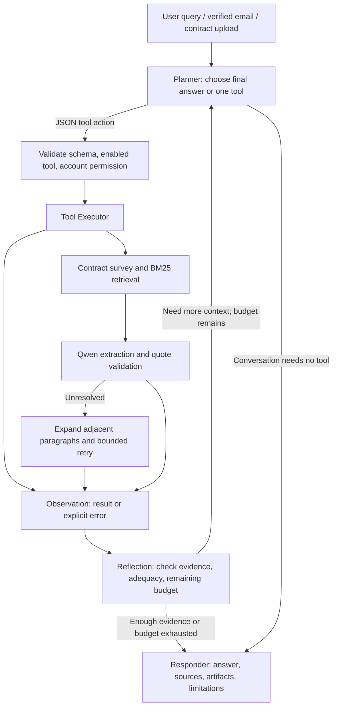

# Contract Review Agent — CSIT6000V

English main guide with Chinese explanations. The assessed model backend is **TACC Qwen**.
中文对照：课程验收必须使用 TACC；本地规则演示只验证工程流程，不替代真实模型推理。

## Project Overview

A web and CLI agent for evidence-grounded contract review and general legal-team conversation.
It reads text PDF, DOCX and TXT files, surveys semantic sections, retrieves candidate paragraphs,
extracts eight standard clause categories or user-defined checks, validates quotations, expands
context when necessary, and creates downloadable Word reports. A general assistant can search
public information, read HTTPS pages, manage private Skills, read owned contracts and start reviews.

There are two execution modes:

- `MODEL_MODE=demo`: deterministic, offline workflow check. Slash commands execute real local tools;
  ordinary natural-language conversation requires a model and deliberately fails clearly here.
- `MODEL_MODE=tacc`: real model planning and extraction. The course SDK route submits a GPU service
  and separate CPU clients. Availability depends on course authorization, queue and GPU memory.

工作流：Agent 根据当前请求规划，执行经过参数与权限校验的工具，检查返回结果是否足够，
必要时继续调用工具，最后输出回答或有原文证据的风险表。每轮最多调用六次工具。
反思是观察结果后的下一步判断，不是展示模型私有思维，也不是另一名独立 Agent。



Outputs support preliminary human review, not a determination of legal enforceability or audit compliance.
No real customer contracts, credentials, model weights or private conversation records belong in Git.

## Architecture

This is **one bounded tool-calling agent plus a review pipeline**, not a multi-agent chat system.
There are no separate agent-role files or agent-to-agent communication claims.

| Component | Implementation | Responsibility / 中文说明 |
|---|---|---|
| Planner | `app/assistant.py`, `prompts/assistant_system.txt` | JSON action selection; 普通聊天或选择下一工具 |
| Tool Executor | `app/assistant.py`, `app/web_tools.py` | Eight validated, account-scoped tools; 工具参数及权限校验 |
| Memory | `web/src/storage.ts`, `app/db.py`, worker checkpoints | Browser history + private task recovery; 浏览器会话与服务端任务恢复 |
| Retriever | `engine.py` | Stable paragraph IDs, semantic sections, lexical BM25 and adjacent expansion |
| Responder | `engine.py`, `app/assistant.py` | Validate quotes, return sources, create reports; 证据校验与文件输出 |
| Model transport | `engine.py`, `app/tacc_sdk.py`, `tacc/client/remote.py` | HTTP JSON or authorized course SDK jobs |
| Harness | `app/worker.py`, `tests/`, `evals/` | Leases, replay, bounded retries, synthetic tests and evaluation |
| Web/API | `web/src/`, `app/main.py` | React three-panel workbench and FastAPI |
| Mail | `mailbox.py`, worker | Optional Microsoft Graph ingestion and replies to verified senders |

Admin visibility is limited to original contracts and final reports across accounts. Ordinary legal
users access their own records. Admin cannot browse other users' private chats, traces, Skills or drafts.
Chat remains in the browser; backend runs/checkpoints can contain request text and are private too.

See [directory tree and submission manifest](docs/PACKAGING.md), including commit/private/generated markers.

## Environment Prerequisite

- Git and **Python 3.12**. Tested runtime: Python 3.12.14. A clean venv is required.
- Exact Python dependencies are in `requirements.txt` and `requirements-lock.txt` (identical pins).
  Main packages: FastAPI 0.162.7, SQLAlchemy 2.1.8, pypdf 7.1.0, python-docx 1.2.0,
  rank-bm25 0.2.2, httpx 0.28.1. Do not mix dependencies from unrelated projects.
- The prebuilt `web/dist/` is committed; **Node is not needed** to run the packaged Web demo.
  Frontend development needs Node 22+ and `npm ci` using `web/package-lock.json`.
- Real course inference additionally requires Linux/WSL, your own authenticated official `tcloud` SDK,
  access to the course bootstrap and Qwen runtime, and scheduler resources.
- No embedding model, external knowledge-base import or vector database is required: retrieval is BM25.
- The existing repository's optional CUAD archive uses Git LFS. It is not needed for startup or synthetic
  acceptance tests; do not require users to download it to run the demo. Actual dataset evaluation needs
  its own download, license review and held-out annotations.
- Web search uses Bing RSS or optional `BRAVE_SEARCH_KEY`. Public HTTPS access is required only for web tools.
  Outlook is optional and needs a dedicated mailbox plus Microsoft Graph authorization.
- No SerpAPI integration, arbitrary code interpreter or unrestricted shell tool is implemented.

| LLM backend | Actual support |
|---|---|
| TACC Qwen via SDK | Course path; real run requires authorized resources, not bundled credentials |
| Course-approved OpenAI-compatible HTTP / vLLM | Transport implemented; supply endpoint/model; not automatically reachable from a laptop |
| OpenAI / LiteLLM compatible endpoint | Same JSON HTTP transport can be configured technically; not the course acceptance route; not live-validated here |
| Anthropic native Messages API | Not implemented; cannot use its native URL with this transport |
| Ollama | No native adapter or installer; OpenAI-compatible endpoint may be adaptable, unverified and not the course route |

中文：不要把“协议兼容”理解成“这些服务均已验收”。课程仍以真实 TACC 结果为准。

## Hardware note

Local CLI, API, browser, parsing and BM25 are CPU workloads; no local GPU is required.
The current course launcher requests **two GPUs**, uses tensor parallelism 2, 16K context,
single concurrency and 55% vLLM memory utilization. This budget does not guarantee availability:
startup checks require at least 14,000 MiB free on each allocated GPU. Shared usage can still change.
The supervisor terminates this job's server process group when the job ends; it does not kill other users' processes.

Ollama/local model weights are not included or required. Smaller local models do not satisfy this project's
TACC assessment. Do not download weights into Git. GPU memory requirements depend on the actual model,
quantization, context and concurrent requests; no local Ollama hardware guarantee is made.

中文：本机无需显卡；模型在 TACC 上运行。排队和显存不足属于外部资源条件，不能靠本地安装依赖解决。

## Step-by-step Reproduction

Run each command from the indicated directory. Paths below are relative to the clone.
Choose **one** platform block. These commands do not contain a real API key.

### Windows PowerShell: Git + Python only

```powershell
git clone https://github.com/Ray-WONG42/csit6000v-contract-review-agent.git
cd csit6000v-contract-review-agent
python --version
python -m venv .venv
.\.venv\Scripts\python.exe -m pip install -r requirements.txt
Copy-Item .env.example .env
.\.venv\Scripts\python.exe demo.py
.\.venv\Scripts\python.exe scripts/launch.py
```

### Linux/macOS: Git + Python only

```bash
git clone https://github.com/Ray-WONG42/csit6000v-contract-review-agent.git
cd csit6000v-contract-review-agent
python3 --version
python3 -m venv .venv
.venv/bin/python -m pip install -r requirements.txt
cp .env.example .env
.venv/bin/python demo.py
.venv/bin/python scripts/launch.py
```

`python --version` / `python3 --version` must show 3.12.x; otherwise select an installed Python 3.12.
The API initializes schema and local demo accounts at startup. CLI demo uses a temporary database,
disposes connections and deletes it afterwards. No knowledge-base import/index build command is needed.
`python scripts/make_fixtures.py` regenerates only the bundled synthetic fixtures if desired.

Open `http://127.0.0.1:8765`. Demo login: `legal@example.com` / `LegalDemo2026!`.
Other demo accounts: `other@example.com` / `OtherDemo2026!`, admin `admin@example.com` / `AdminDemo2026!`.
These are public local demo credentials, never production credentials. Stop with Ctrl+C in the launcher.
For database migrations on an existing installation use `python -m alembic upgrade head` inside the venv.

### Required course path: activate real TACC

The repository does not supply a TACC account, SDK private key or course environment installer.
First follow the teaching team's SDK/authentication instructions using **your own** account.
On Windows verify `tcloud` from the WSL distribution used by the app:

```powershell
wsl -- bash -lic 'tcloud ps'
```

Then open a WSL terminal in the clone and run `bash tacc/setup-course.sh`.
The course bootstrap and model installation are external prerequisites. Their public cluster paths in
`tacc/` refer to the teaching environment, not local project storage; confirm them with the current course release.

Edit only your private `.env`:

```dotenv
APP_DEMO=1
MODEL_MODE=tacc
TACC_PROTOCOL=sdk
TACC_MODEL=qwen3.8-27b
```

`APP_DEMO=1` keeps the synthetic local login/mail sandbox while model inference is real.
Leave `TACC_URL`, `LLM_BASE_URL` and keys blank in SDK mode. The service address is discovered from the job log.

```powershell
.\.venv\Scripts\python.exe scripts/tacc_service.py start --wait 480
.\.venv\Scripts\python.exe scripts/tacc_service.py status --wait 60
.\.venv\Scripts\python.exe scripts/check_connections.py --live
.\.venv\Scripts\python.exe demo.py --live
.\.venv\Scripts\python.exe scripts/launch.py
```

Linux uses `.venv/bin/python` for the same commands. `start` submits work; it does **not** bypass scheduling.
If start times out, inspect the queue and known job before submitting again. `status` may wait for startup.
`python scripts/tacc_service.py adopt JOB_ID --wait 60` reconnects a verified existing service job.
Use `python scripts/tacc_service.py stop` when finished. Service lifetime is capped at one hour.
No real TACC result is guaranteed until the probe and live demo actually succeed.

For an approved HTTP endpoint instead, set `TACC_PROTOCOL=chat`, `MODEL_MODE=tacc`,
`TACC_URL=https://your-approved-host/v1/chat/completions`, `TACC_MODEL=your-model-id`
and `TACC_API_KEY` if required. The SDK's cluster-only HTTP address is not a public laptop endpoint.
Alternatively `LLM_BASE_URL` accepts the `/v1` base; `MODEL_NAME` and `LLM_API_KEY` are aliases.
Nonblank `TACC_*` takes precedence. Never put keys in source or browser variables.

### Optional frontend development

```bash
npm --prefix web ci
npm --prefix web run dev
```

Start the backend separately with `python scripts/launch.py --no-browser`.
Set `APP_PUBLIC_URL=http://localhost:5173` for the browser development origin and open that exact URL.
`VITE_API_TARGET=http://127.0.0.1:8765` configures the development proxy; frontend requests use relative `/api` paths.
Production serves frontend and API from one origin. Rebuild with `npm --prefix web run build` and commit
the sanitized `web/dist/` after UI or VITE configuration changes. Never place secrets in `VITE_*`.

## Demo Test Case

**Offline standard query** (free conversation panel, demo mode):

```text
/创建Skill {"name":"Reproduction Demo","categories":[],"focus":"Check payment deadlines","policy":"evidence-only@1"}
```

Success means the actual `save_skill` tool event appears, one Skill belongs to the logged-in user,
and the response reports a saved Skill. Sending the command again as a new turn creates a new Skill;
retrying the same run reuses its checkpoint. CLI `python demo.py` additionally reviews the synthetic
contract and finishes with `{"status":"PASS","mode":"demo","tool_called":true,"artifact_count":1}`.
This confirms tool execution and pipeline plumbing, **not natural-language model reasoning**.

**Real TACC standard query**:

```text
请调用 create_document 工具生成一个名为 Demo 的 Word 文档，正文为：Contract review demo succeeded。然后告诉我保存结果。
```

Success means a real model decision, a successful `create_document` event, and a downloadable DOCX
containing that text, followed by a final answer. `python demo.py --live` must exit 0 with `mode=tacc`
and `tool_called=true`; it is isolated and checks artifact creation. A live probe must separately report
`tacc_test=true`. For custom review run `python scripts/tacc_review_smoke.py`: it checks the synthetic
45-day payment term and three-year confidentiality evidence, rather than only the fixed eight categories.
Web research can be tested with `/读取 https://www.python.org/`; success includes source URL and real page text.

中文：只有界面能打开、或者离线 PASS，不代表模型验收通过。真实验收必须产生 TACC 模型结果与实际工具产物。

## Agent Configuration Guide

| Change | Where and how |
|---|---|
| General system prompt | `prompts/assistant_system.txt` |
| Tool-use rules | `prompts/tool.txt`; parameter schemas and descriptions remain code in `app/assistant.py` |
| Reflection after observations | `prompts/reflection.txt`; no separate critic or chain-of-thought output |
| Contract extraction and survey | `prompts/contract_system.txt`, `prompts/survey.txt` |
| Enable/disable tools | `.env` `AGENT_TOOLS`, comma-separated exact tool IDs without spaces; per-turn Web toggle additionally disables search/read |
| Temperature | `.env` `LLM_TEMPERATURE=0`; SDK transports this setting too |
| Output/context budget | `TACC_MAX_OUTPUT_TOKENS=1800`, `TACC_CONTEXT_LIMIT=16384`; never exceed the server's configured context |
| Short-term conversation | `AGENT_SHORT_TERM_MEMORY=0` omits prior turns from planner input; default keeps last four messages, each bounded |
| Browser persistent memory | `VITE_PERSIST_CHAT=0`, then rebuild frontend; uses page-lifetime memory for new messages instead of IndexedDB/localStorage |
| Durable tasks/contracts | Always under `APP_DATA=data`; checkpoints are needed for recovery and are not disabled by browser-memory settings |
| Model identity | HTTP: `TACC_MODEL` or `MODEL_NAME`; SDK course identity enforced in `tacc/client/remote.py` and service launcher |

Restart API and worker after backend configuration/prompt changes. New SDK clients copy all prompt templates
with the review engine; no dependency on this developer's directories. The browser toggle does not erase
previously saved browser data: clear site storage to remove it. No automatic long-term semantic memory exists.
Embedding/vector/SerpAPI fields in `.env.example` are explicitly reserved and unused; changing them does nothing.

Tool schemas are ordinary JSON, not provider-native function calling. The planner must return either
`{"action":"final","answer":"..."}` or a validated `{"action":"tool","tool":"...","arguments":{...}}`.
Tool execution never grants the model another user's permissions. Web/contract text cannot authorize writes.

## Troubleshooting FAQ

1. **API fails / base URL wrong / 401 or 404.** Use `/v1/chat/completions` for `TACC_URL`, but `/v1` for
   `LLM_BASE_URL`. Check model ID, key and endpoint protocol. Native Anthropic Messages is incompatible.
   Do not log Authorization headers or paste `.env` into an issue.
2. **TACC queue or insufficient GPU memory.** `PD (Priority)` and `PD (Resources)` mean pending, not model
   failure. Check `tcloud ps` and the job's own log. Do not resubmit repeatedly. For a verified busy node,
   `python scripts/tacc_service.py start --exclude-node NODE --wait 480` applies to a new submission;
   an already-running saved job is reused. Only cancel your own jobs. Ask teaching staff to inspect shared
   memory/orphan workers when needed; a local retry cannot free others' GPU memory.
3. **SDK timeout but submission may exist.** Inspect queue and log before adopting a verified job ID.
   Do not guess an unrelated user's job. Windows/WSL may hold a staging directory after a timeout.
   Retain the directory until the submitting process exits; do not recursively delete active directories.
4. **Ollama model not pulled.** Ollama is not part of this course setup; this is not solved by adding a
   model name to `.env`. Use the required TACC release. No Ollama installation is performed by this project.
5. **Vector database missing / embedding load failed.** This version uses BM25 with no embedding import,
   Chroma, FAISS or external knowledge-base build step. Check the uploaded text instead. Reserved vector
   environment variables cannot enable an unimplemented backend.
6. **Tool format error / model does not follow function-call instructions.** Read `prompts/tool.txt`,
   confirm context/output budgets and a JSON-capable model. The transport parses a JSON action object,
   not native OpenAI `tool_calls`. Invalid output fails explicitly; mocked tests do not prove live compliance.
7. **Proxy / VPN / public search fails.** Check DNS, HTTPS reachability and `HTTP_PROXY`/`HTTPS_PROXY`/`NO_PROXY`.
   Only public HTTPS pages are allowed; private addresses, credentials in URLs and non-443 ports are rejected.
   For cluster clients ensure the course internal host is reachable from the client job, not your browser.
   Bing RSS has limited search quality; an optional Brave key improves provider choice but needs its own access.
8. **Only ordinary chat fails in demo.** Expected: demo does not imitate a general LLM. Use the documented
   slash-command self-test or configure a real TACC backend.
9. **Missing frontend / Node absent.** Ensure `web/dist/index.html` and its hashed assets were committed.
   A correctly packaged clone needs no Node. Editing the frontend requires Node and a rebuild.
10. **403 during frontend development.** Open the exact origin configured in `APP_PUBLIC_URL`, use the Vite
    `/api` proxy and retain session/CSRF handling. Do not disable permission checks to make the UI work.
11. **SQLite locked on Windows after isolated demo.** Connections must be disposed before temporary data
    cleanup. The supplied CLI handles disposal. Never delete the real application's open `data/` directory.
12. **New checkout cannot import prompt files.** Commit `prompt_loader.py` and all `prompts/*.txt`; the SDK
    client must copy them too. Run from the repository or use the included location-independent shell wrapper.

Run regression tests with `python -m pytest -q`. Linux-only cleanup integration test:
`python scripts/check_tacc_cleanup.py`. Review [reproduction evidence](docs/REPRODUCTION_REPORT.md) for
what was actually run and external checks still pending. Real mailbox, cloud deployment and model-quality
evaluation require their own inputs and must not be inferred from offline tests.

## License

No open-source license has been granted yet; see [LICENSE](LICENSE). The team must agree on licensing
and confirm redistribution terms for course-provided cleanup code before public publication.
Third-party packages keep their original licenses. Refer to the [official tcloud SDK](https://github.com/turingaicloud/tcloud-sdk)
for SDK prerequisites; no SDK account or private key is distributed here.

中文：当前保留权利声明，不擅自替小组选择 MIT 等开源许可。上传公开仓库前请确认小组及课程代码的授权。
